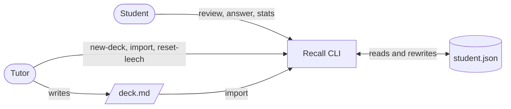
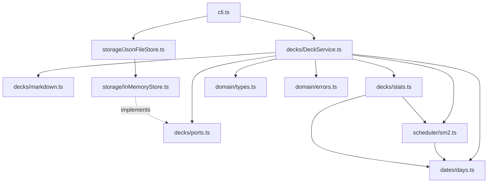

# Recall: architecture

Handover notes. I wrote Recall over a couple of weekends for the anatomy students I
tutored; it does one thing and the code is small enough to read in an afternoon. This
file says how it is put together and what I knew was unfinished when I left.

## Context

Recall is a flashcard scheduler. A student owns one JSON file holding their decks, cards
and review history. Each day they ask for a session, grade what comes up, and the
scheduler (a simplified SM-2) decides when each card returns. The tutoring centre uses the
same CLI to prepare decks and to look at a student's statistics when they come in for help.

Out of scope, on purpose: accounts, sync between machines, a graphical interface, audio or
image cards, and anything that needs the network.

## Components

- `domain/types.ts`: the entities (`Deck`, `Card`, `CardState`, `Review`, `Session`) as
  readonly plain objects, plus the handful of constants the rules below refer to.
- `domain/errors.ts`: one `DomainError` with a `code`. The CLI prints the message and
  exits 1; nothing else is caught.
- `dates/days.ts`: calendar-day strings (`'2026-11-17'`), `addDays`, `compareDays`,
  `todayFrom(clock)`. All date arithmetic in the program goes through here.
- `scheduler/sm2.ts`: `schedule(state, grade, today)` and `easeAfter`. Pure.
- `decks/ports.ts`: `RecallStore` (what storage must provide) and `IdGenerator`.
- `decks/DeckService.ts`: the only class with behaviour. It takes a store, an id generator
  and a clock, and exposes every operation the CLI offers.
- `decks/markdown.ts`: the `Q:`/`A:` import parser. Pure, and the weakest file here (see
  limitations).
- `decks/stats.ts`: `deckStats(cards, reviews, today)`. Pure.
- `storage/InMemoryStore.ts`: `Map`-backed store; tests use it directly.
- `storage/JsonFileStore.ts`: extends the in-memory store and rewrites the whole file
  after every write.
- `cli.ts`: argv parsing by hand, one small function per command, plain-text output.

## Key rules

These are the rules the code implements. Issues and tests cite them by number.

- **R1** A card is due when `due <= today`.
- **R2** A session is the due cards of a deck, oldest due first, capped at `limit`
  (default 20).
- **R3** Grade >= 3 is a pass: repetitions += 1; interval = 1 if repetitions was 0, 6 if
  it was 1, otherwise round(interval x ease); due = today + interval.
- **R4** Grade < 3 is a lapse: repetitions = 0, interval = 1, lapses += 1, due = tomorrow.
- **R5** After every review ease' = ease + (0.1 - (5 - g) x (0.08 + (5 - g) x 0.02)); ease
  never drops below 1.3.
- **R6** A card with >= 8 lapses is a leech and is excluded from sessions until reset.
- **R7** Dates are calendar days; "today" comes from an injected clock, never the wall
  clock.
- **R8** Importing a Markdown file (`Q: ...` / `A: ...` pairs, optional `#tag` line before
  a pair) creates cards; duplicates (same front in the same deck, case-insensitive) are
  skipped and reported.
- **R9** Stats for a deck: total, due today, new (repetitions 0), learning (interval < 21),
  mature (>= 21), leeches, reviews in the last 7 days.

## Decisions

- [ADR 0001: Store everything in one JSON file per student](docs/adr/0001-one-json-file-per-student.md)

I considered a `Scheduler` interface (`schedule`, `newState`) so that a deck could choose
its algorithm, and decided not to build it until a second algorithm existed. The call
sites are all in `DeckService` (`addCard`, `answer`, `resetLeech`) and `stats.ts`
(`isLeech`), so it is a contained change when the time comes. I did not write an ADR for
that; whoever adds the second algorithm should.

## Known limitations

- `markdown.ts` is a line-by-line state machine that tolerates nothing: blank lines between
  pairs, leading whitespace or a `Q:` without the trailing space produce a syntax error, and a
  CRLF file imports with a stray `\r` on every tag. It needs a rewrite, not a patch.
- `stats.ts` computes "reviews in the last 7 days" by scanning the whole review list once
  per card. Fine for 36 cards, quadratic in general.
- `cards --tag` takes exactly one tag. There is no way to ask for cards with any of several.
- There is no forecast: `stats` says how many cards are due today but not how many come
  due tomorrow or next week.
- A large import makes every new card due today, so the next session is flooded. Other
  tools cap new cards per day; this one does not.
- Editing a card's text is not supported at all. There is no delete command either, and
  I never decided whether an edited card should keep its schedule.

## Where to start reading

1. `src/domain/types.ts`, five minutes.
2. `src/scheduler/sm2.ts` next to R3-R6 above, then `tests/sm2.test.ts`.
3. `src/decks/DeckService.ts` top to bottom; `session` and `answer` are the heart of it.
4. `src/cli.ts` only when you need to add a command; there is no logic worth reading in it.
